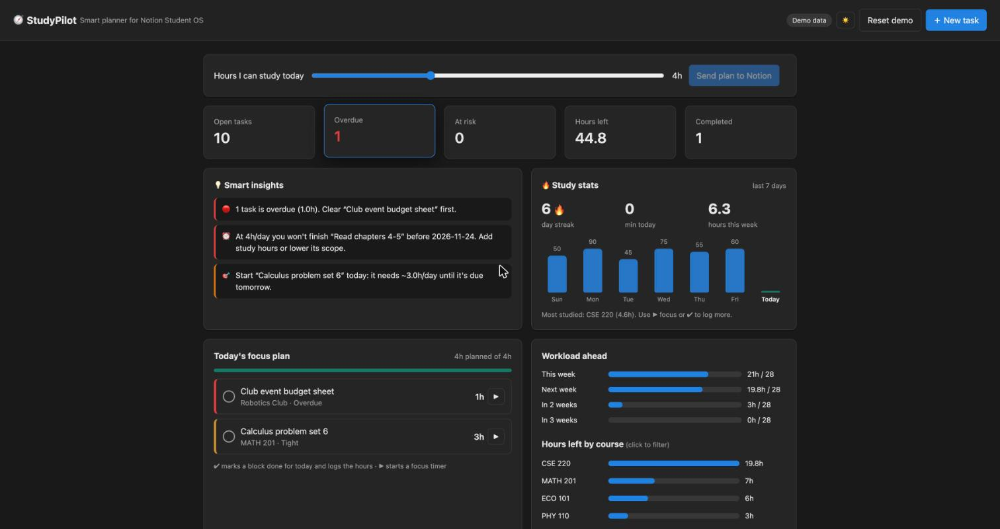
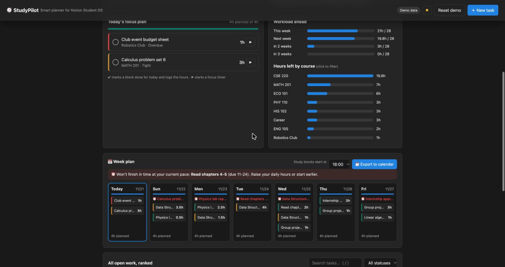

# 🧭 StudyPilot: a smart planner for Notion Student OS

**StudyPilot turns your Notion assignments database into a daily study plan, a 7-day schedule and a deadline-risk radar, then writes the plan back into Notion.**

Built for the **Cognition × Notion Student OS Hackathon**.



## The problem

Student OS templates in Notion are great for *storing* assignments, exams and projects, but they don't tell you **what to work on today**. Students end up:

- starting big projects too late because a due date "looked far away",
- missing small deadlines buried under big ones,
- discovering an overloaded week (two exams + a project) only when it's already here.

## What StudyPilot does

1. **Reads your Assignments database** from Notion (title, course, due date, status, priority, effort hours, progress %).
2. **Ranks all open work** by a pressure score: remaining hours ÷ days left, plus urgency, weighted by priority. Overdue work always floats to the top.
3. **Builds today's focus plan** that fits the hours you actually have (e.g. 4h), spreading big tasks across the days before their deadline instead of cramming.
4. **Plans the whole week**: simulates the next 7 days, places every study hour, and warns about work that **won't finish before its deadline** at your current pace.
5. **Flags deadline risk** for every task: 🔴 overdue · 🟠 at risk (can't fit before the deadline) · 🟡 tight · 🟢 on track.
6. **Writes everything back into Notion**: logged progress and status update your database rows, new tasks become rows, and the daily plan becomes a "Today's Plan · YYYY-MM-DD" page with checkable to-dos.



## Features

**Plan**
- 🧭 **Today's focus plan** sized by an "hours I can study today" slider
- 📅 **Week plan**: 7 days of study blocks and deadlines, with a "won't finish in time" warning
- 📈 **Workload ahead** per week (with overload warnings) and **hours left per course**
- 💡 **Smart insights**: coaching tips like *"Start Calculus today: it needs ~3h/day"* or *"Next week is overloaded by 5h"*

**Do**
- ✔ **Tick off plan blocks** to log the hours on that task
- ▶ **Focus timer** (15 / 25 / 50 min) with a progress ring; it logs the time to the task when you finish
- ➕ **Add tasks** (press `N`), drag **progress sliders**, mark tasks **done**, all with **Undo**
- 🔥 **Study stats**: minutes per day for the last 7 days, day streak, most-studied course

**Organize & share**
- 🔎 **Search** (`/`), filter by **course** or **risk** (click a stat card or course bar), **sort** any column
- 🗓️ **Export to calendar (.ics)**: study blocks (choose your start time) and deadlines into Google, Apple or Outlook Calendar
- 📝 **Send plan to Notion**: creates today's plan page inside your Student OS
- 🌙 **Light / dark theme** toggle

**Feel**
- Every change **re-plans your day instantly**
- App-style motion: staggered entrances, loading skeletons, count-up numbers, animated re-ranking (FLIP), growing bars, ripples. Respects the *reduce motion* setting.

With no Notion keys it runs in **demo mode** on sample data, so anyone can try it in seconds. It also has a **CLI** (`npm run plan`, `npm run sync`).

## How it uses Notion Student OS

- **Notion API** through a small built-in client in [`src/notion.js`](src/notion.js) (no SDK dependency):
  - `POST /databases` creates the Assignments database (`npm run setup`)
  - `POST /databases/{id}/query` reads all tasks (with pagination)
  - `POST /pages` adds tasks and creates the daily plan page
  - `PATCH /pages/{id}` writes progress and status back when you log work
- `npm run setup` **creates a Student OS-style "Assignments" database** in your workspace (Course, Type, Due, Status, Priority, Effort (h), Progress %) and fills it with sample tasks.
- Works with **existing Student OS templates** too: the property mapper accepts common names (`Due` / `Due Date` / `Deadline`, `Course` / `Class` / `Subject`, `Status` as select, status or checkbox, `Progress` as 0–1 or 0–100).

## How AI was used to build it

StudyPilot was built with AI coding agents. The planning engine, Notion client, dashboard and tests were written by an AI coding agent from a short spec: "rank student work by real time pressure, fit it into the hours available today, and write the plan back into Notion".

## Run it

Requires **Node.js 18+**. There are no npm dependencies.

```bash
git clone https://github.com/SahinurDEV/studypilot.git
cd studypilot

npm start          # dashboard at http://localhost:3000 (demo data until Notion is connected)
npm run plan       # print today's plan in the terminal
npm run plan 6     # ...for 6 available hours
npm test           # run the unit tests
```

### Connect your Notion

1. Go to <https://www.notion.so/profile/integrations> → **Developer connections** → **New connection**. Choose **API token** and create it.
2. Create (or pick) a page for StudyPilot, open **••• → Connections**, and add your connection.
3. Copy `.env.example` to `.env`. Set `NOTION_PARENT_PAGE_ID` to the 32-character ID at the end of the page URL. For the token, either paste it after `NOTION_TOKEN=`, or copy it in Notion and run `npm run token` (macOS: reads the clipboard and saves it without printing it).
4. Run `npm run setup`. This creates the Assignments database and prints `NOTION_DATABASE_ID`; add it to `.env`.
   *Already have a Student OS assignments database? Share it with the connection and put its ID in `NOTION_DATABASE_ID` instead.*
5. `npm start`. The dashboard now shows **Live from Notion**, and **Send plan to Notion** works. From the terminal: `npm run sync`.

### Configuration (`.env`)

| Variable | Purpose |
|---|---|
| `NOTION_TOKEN` | API token of your Notion connection |
| `NOTION_PARENT_PAGE_ID` | Page that holds the database and the daily plan pages |
| `NOTION_DATABASE_ID` | Your Assignments database |
| `STUDY_HOURS_PER_DAY` | Usual study hours per day (default `4`), used for risk and the week plan |
| `PORT` | Dashboard port (default `3000`) |

`.env` is git-ignored, so your token never leaves your machine.

## API

| Method | Path | Does |
|---|---|---|
| `GET` | `/api/plan?hours=4` | Plan, ranking, week schedule, workload, insights, study stats |
| `POST` | `/api/tasks` | Add a task |
| `PATCH` | `/api/tasks/:id` | Log hours (`addHours`), set `progress` or `status` |
| `POST` | `/api/sync?hours=4` | Write today's plan into Notion |
| `GET` | `/api/calendar.ics?start=18` | Download the 7-day schedule as a calendar file |

## Project structure

```
src/planner.js     ranking, risk, daily plan, week schedule, insights, study stats, .ics export (pure functions)
src/notion.js      Notion API client + page → task mapping
src/server.js      dashboard server + JSON API
src/cli.js         setup / plan / sync commands
src/save-token.js  saves the Notion token from the clipboard into .env
src/config.js      reads .env
src/sample.js      demo tasks and study sessions
public/            dashboard UI (HTML / CSS / JS, no framework)
test/              node:test unit tests (10 tests)
docs/              screenshots
```

## How the score works

```
remaining = effort × (1 − progress)
pressure  = remaining ÷ max(daysLeft, 0.5)
score     = (pressure × 4 + 10 ÷ (daysLeft + 1)) × priorityWeight   # High 1.5, Medium 1, Low 0.7
overdue   → score 1000+ (always first)
at risk   → remaining > daysLeft × studyHoursPerDay
```

The **week plan** runs the daily planner for each of the next 7 days, counting each day's planned hours as done before planning the next day. Any task still unfinished on its due date is reported as "won't finish in time".

## License

MIT
